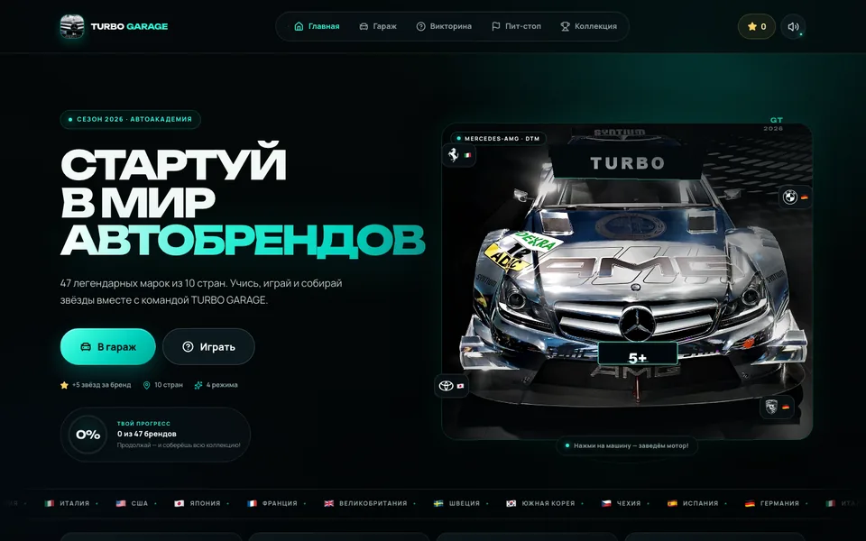
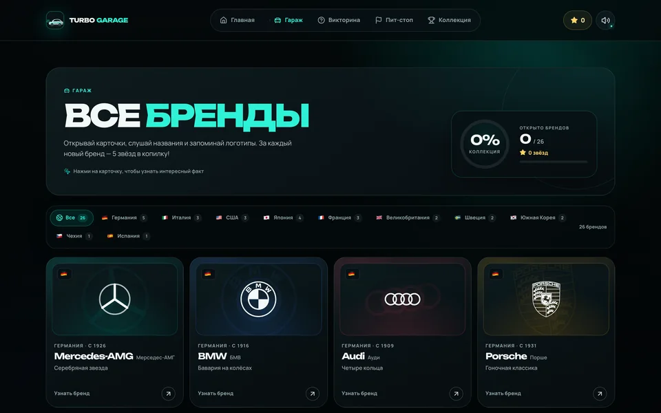
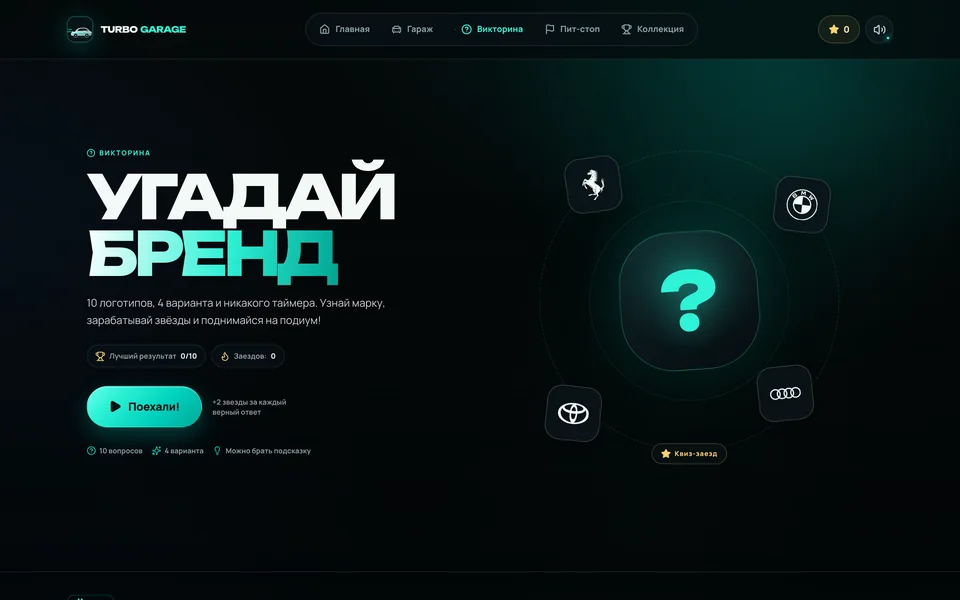
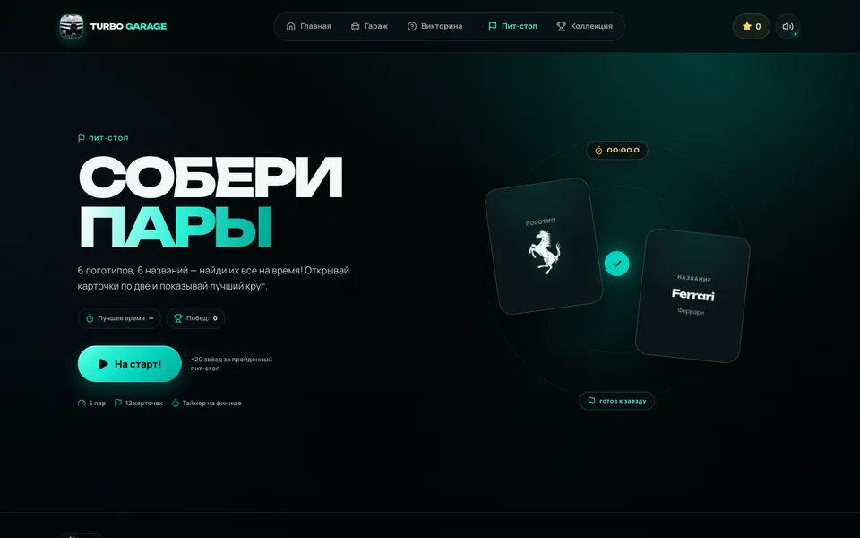
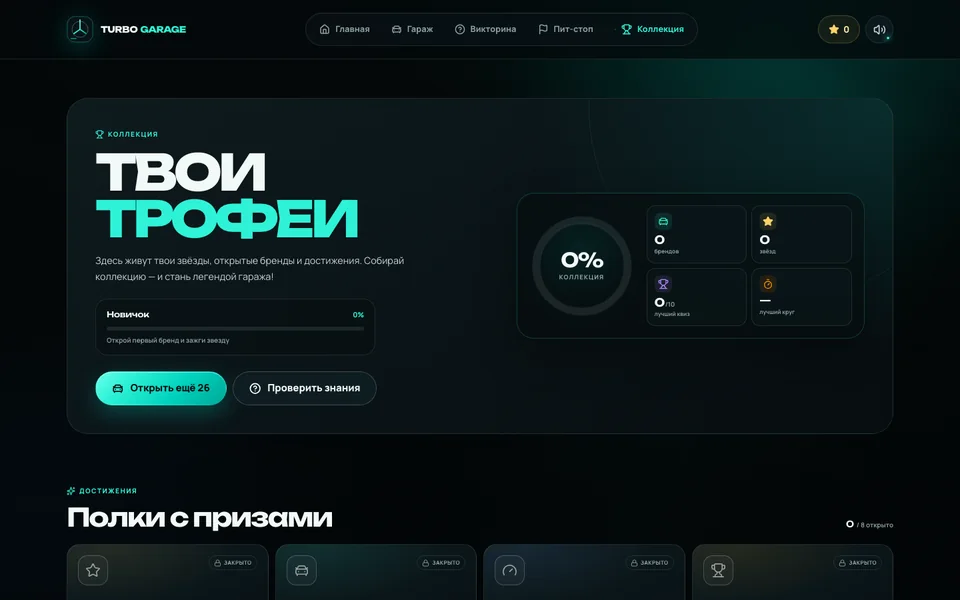
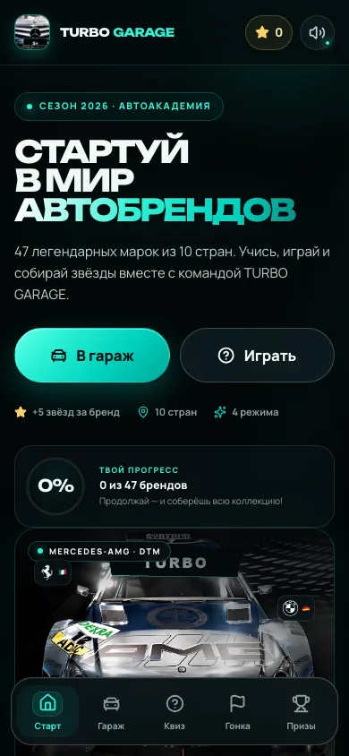
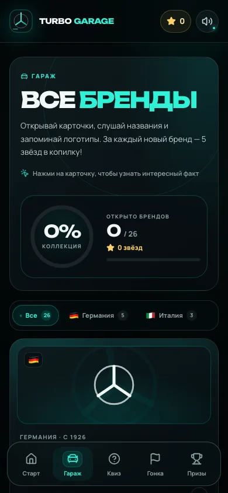

<div align="center">


# TURBO GARAGE · ТУРБО ГАРАЖ

**Автоакадемия для юных чемпионов 5+**

Учись узнавать автомобильные бренды, собирай звёзды, проходи викторины и ставь рекорды пит-стопа.
47 легендарных марок из 10 стран — в одном ярком гоночном гараже.

[](https://react.dev/)
[](https://www.typescriptlang.org/)
[](https://vite.dev/)
[](https://sass-lang.com/)
[](https://reactrouter.com/)
[](https://motion.dev/)
[](https://nodejs.org/)


**React Router 7 · декларативный режим · GitHub Pages ready**

</div>

---

## 🧭 Содержание

- [О проекте](#-о-проекте)
- [Скриншоты](#-скриншоты)
- [Возможности](#-возможности)
- [Стек](#-стек)
- [Быстрый старт](#-быстрый-старт)
- [Скрипты](#-скрипты)
- [Маршруты](#-маршруты)
- [Структура проекта](#-структура-проекта)
- [Данные и бренды](#-данные-и-бренды)
- [Публикация на GitHub Pages](#-публикация-на-github-pages)
- [Качество и проверки](#-качество-и-проверки)
- [Доступность](#-доступность)
- [Благодарности](#-благодарности)

---

## 📖 О проекте

**TURBO GARAGE** — русскоязычная браузерная игра для детей от 5 лет, которая знакомит с логотипами автомобильных брендов в формате гоночной академии. Здесь нет скучных тестов: ребёнок открывает карточки, слушает названия, отвечает на вопросы, ищет пары на время и постепенно собирает коллекцию.

Визуальный стиль вдохновлён ливреей **Mercedes-AMG Petronas Formula One 2026**: бирюзовый Petronas, глубокий карбон, серебро, неоновые акценты и гоночная графика. В Hero-блоке — реальный **Mercedes-AMG C204 DTM**, а логотип и favicon — его квадратные фрагменты с фирменной решёткой и трёхлучевой звездой.

<div align="center">

🇩🇪 Германия · 🇮🇹 Италия · 🇺🇸 США · 🇯🇵 Япония · 🇫🇷 Франция
🇬🇧 Великобритания · 🇸🇪 Швеция · 🇰🇷 Южная Корея · 🇨🇿 Чехия · 🇪🇸 Испания

</div>

<details>
<summary><strong>🏁 Показать все 47 брендов</strong></summary>

<br />

**🇩🇪 Германия:** Mercedes-AMG · BMW · Audi · Porsche · Volkswagen · Opel · Smart<br />
**🇮🇹 Италия:** Ferrari · Lamborghini · Fiat · Alfa Romeo · Maserati<br />
**🇺🇸 США:** Ford · Tesla · Jeep · Chevrolet · Cadillac · Chrysler<br />
**🇯🇵 Япония:** Toyota · Honda · Nissan · Mazda · Subaru · Mitsubishi<br />
**🇫🇷 Франция:** Renault · Peugeot · Bugatti · Citroën · DS Automobiles<br />
**🇬🇧 Великобритания:** McLaren · MINI · Aston Martin · Bentley<br />
**🇸🇪 Швеция:** Volvo · Koenigsegg · Polestar · Scania<br />
**🇰🇷 Южная Корея:** Hyundai · Kia · Genesis · Daewoo<br />
**🇨🇿 Чехия:** Škoda · Tatra · Praga<br />
**🇪🇸 Испания:** SEAT · CUPRA · Hispano-Suiza

</details>

> **Для кого:** дети 5+, родители, педагоги и все, кто любит автомобили.<br />
> **Прогресс:** сохраняется автоматически в `localStorage` браузера.

---

## 📸 Скриншоты

| 🏠 Главная | 🚗 Гараж |
|:---:|:---:|
|  |  |
| **Викторина** | **Пит-стоп** |
|  |  |
| **Коллекция** | **Мобильные экраны** |
|  |   |

---

## ✨ Возможности

### 🎮 Четыре игровых режима

| Режим | Механика | Награда |
|:---|:---|:---:|
| 🏠 **Гараж** | 47 карточек брендов, фильтр по стране, логотип, факт и озвучивание названия | ⭐ +5 звёзд |
| ❓ **Викторина** | 10 вопросов «чей это логотип?», 4 варианта, подсказка страны и объяснение ответа | ⭐ +2 за ответ<br />⭐ +10 за 10/10 |
| 🏁 **Пит-стоп** | 6 пар «логотип — название», таймер, ходы и лучший круг | ⭐ +20 за заезд |
| 🏆 **Коллекция** | Уровни, 8 достижений, прогресс по странам, звёзды и рекорды | 🏅 Бейджи |

### 🎨 Дизайн и анимации

- Гоночная палитра Mercedes-AMG Petronas: `#00d2be`, `#2ef2d6`, карбон и серебро.
- Реалистичный Mercedes-AMG C204 DTM в Hero-блоке: снимок с фирменным баннером TURBO и табличкой 5+, который «заводится» по клику.
- Логотип и favicon — фрагменты того же Hero-снимка: решётка, трёхлучевая звезда и табличка 5+.
- Плавные переходы страниц и появление карточек на `framer-motion`.
- Конфетти, звёздные вспышки и анимация прогресса.
- Бесконечно прокручивающийся тикер стран, кольца прогресса и floating-чипы брендов.
- Локальные шрифты **Unbounded** и **Manrope** — без запросов к Google Fonts.

### 🧠 Механики прогресса

- Изучение бренда начисляет звёзды и открывает карточку в коллекции.
- Викторина запоминает лучший результат и количество попыток.
- Пит-стоп сохраняет лучший круг и общее число побед.
- 8 достижений: от «Первого шага» до «Звёздного чемпиона» на 100 звёзд.
- Отдельная статистика по 10 странам и уровням: Новичок → Легенда гаража.

### 📱 Адаптивность и доступность

- Полностью адаптивная вёрстка от **320 px** до широких мониторов.
- Мобильная нижняя навигация и горизонтальный скролл фильтров стран.
- Навигация с клавиатуры, skip-link и видимые focus-ring.
- Модальные окна закрываются по `Escape`, фокус удерживается внутри.
- Поддержка `prefers-reduced-motion` для основных анимаций.
- Переключатель звука и синтез речи для названий брендов.

---

## 🛠 Стек

| Слой | Технологии |
|:---|:---|
| **UI** | React 19, TypeScript 5.9, SCSS Modules |
| **Сборка** | Vite 8, Rolldown, Node.js 22 |
| **Маршрутизация** | React Router 7, декларативный режим (`BrowserRouter`, `Routes`, `NavLink`) |
| **Анимации** | Framer Motion |
| **Иконки** | Lucide React |
| **Эффекты** | Canvas Confetti |
| **Звук** | Web Audio API + Speech Synthesis API |
| **Шрифты** | Fontsource: Unbounded, Manrope |
| **Хранение** | `localStorage` |
| **Деплой** | GitHub Actions → GitHub Pages |

---

## 🚀 Быстрый старт

### Требования

- **Node.js 22+** — версия закреплена в `.nvmrc`
- npm 10+
- современный браузер с поддержкой Web Audio API

### Установка

```bash
git clone https://github.com/<username>/react-ts-car-brands.git
cd react-ts-car-brands

nvm use
npm install
npm run dev
```

Приложение откроется на **http://localhost:5173**.

### Production-сборка

```bash
npm run build
npm run preview
```

Готовые файлы появятся в `dist/`.

---

## 📜 Скрипты

| Команда | Что делает |
|:---|:---|
| `npm run dev` | Запускает Vite dev-сервер с HMR |
| `npm run build` | Проверяет типы через `tsc -b` и собирает production-версию |
| `npm run preview` | Локально запускает собранный `dist` |
| `npm run typecheck` | Проверяет TypeScript без emit |

---

## 🗺 Маршруты

Приложение использует **React Router 7 в декларативном режиме** и `BrowserRouter`. Базовый путь берётся из `import.meta.env.BASE_URL`, поэтому проект работает и в корне домена, и в подпапке GitHub Pages.

| Путь | Страница | Описание |
|:---|:---|:---|
| `/` | 🏠 Главная | Hero, Mercedes-AMG C204 DTM, статистика, выбор режима и бренд дня |
| `/garage` | 🚗 Гараж | Каталог брендов с фильтром по стране и модальными карточками |
| `/quiz` | ❓ Викторина | 10 вопросов с вариантами ответа и подсказками |
| `/race` | 🏁 Пит-стоп | Игра на память с таймером и результатами |
| `/collection` | 🏆 Коллекция | Прогресс, достижения, рекорды и статистика |
| `*` | ↩️ Fallback | Перенаправление на главную |

---

## 🧱 Структура проекта

```text
.
├── .github/
│   └── workflows/
│       └── deploy.yml          # CI/CD: сборка и деплой на GitHub Pages
├── docs/
│   └── screenshots/            # Скриншоты для README
├── public/
│   ├── favicon.png             # Favicon из Hero-снимка
│   └── apple-touch-icon.png    # Иконка для iOS
├── src/
│   ├── assets/
│   │   ├── mercedes-dtm-hero.webp   # Hero-снимок Mercedes-AMG C204 DTM
│   │   └── mercedes-dtm-logo.webp   # Логотип — фрагмент Hero-снимка
│   ├── components/             # Header, Footer, BrandCard, BrandModal,
│   │                           # HeroCar, ProgressRing, Button, Logo...
│   ├── data/
│   │   ├── brands.ts           # 47 брендов: факты, страны, акценты
│   │   ├── countries.ts        # 10 стран с флагами
│   │   ├── brandLogos.ts       # Объединённый реестр логотипов
│   │   ├── automotiveBrandLogoPaths.ts  # SVG-пути автомобильных марок
│   │   └── customBrandLogos.ts # Дополнительные нарисованные логотипы
│   ├── hooks/
│   │   └── useBodyLock.ts      # Блокировка скролла при открытой модалке
│   ├── lib/
│   │   ├── audio.ts            # Web Audio API и синтез речи
│   │   ├── celebrate.ts        # Конфетти и празднования
│   │   ├── format.ts           # Форматирование времени
│   │   └── random.ts           # Перемешивание карточек
│   ├── pages/
│   │   ├── HomePage.tsx
│   │   ├── GaragePage.tsx
│   │   ├── QuizPage.tsx
│   │   ├── RacePage.tsx
│   │   └── CollectionPage.tsx
│   ├── state/
│   │   └── AppContext.tsx      # Прогресс, звёзды, рекорды, localStorage
│   ├── styles/
│   │   ├── _mixins.scss        # Брейкпоинты, focus-ring, reduced-motion
│   │   └── global.scss         # Переменные, reset, общие утилиты
│   ├── App.tsx                 # Маршруты, переходы, layout
│   ├── main.tsx                # BrowserRouter + basename
│   ├── types.ts                # Общие TypeScript-типы
│   └── vite-env.d.ts
├── .gitignore
├── .nvmrc
├── index.html
├── package.json
├── tsconfig.json
├── vite.config.ts
└── README.md
```

---

## 🧩 Данные и бренды

Все данные хранятся в обычных TypeScript-массивах — без базы данных и API.

### Добавить новый бренд

1. Добавьте запись в `src/data/brands.ts`:

```ts
{
  id: 'new-brand',
  name: 'New Brand',
  nameRu: 'Новый бренд',
  country: 'germany',
  since: 2026,
  logo: 'newbrand',
  tagline: 'Короткий слоган',
  fact: 'Интересный факт для ребёнка.',
  accent: '#00d2be',
}
```

2. Добавьте SVG-путь логотипа в `src/data/brandLogos.ts` (например, из [Simple Icons](https://simpleicons.org/)).
3. Если нужна новая страна — добавьте её в `src/data/countries.ts`.
4. Проверьте, что количество брендов и стран обновилось автоматически: интерфейс считает статистику из массивов.

### Источники логотипов

- Большинство логотипов взято из **Simple Icons** (CC0) и встроено как SVG-пути.
- Логотип **Mercedes-AMG** в каталоге брендов нарисован отдельно в стиле проекта.
- Логотип и favicon **TURBO GARAGE** — фрагменты Hero-фотографии Mercedes-AMG C204 DTM.
- Все товарные знаки принадлежат их владельцам. Проект носит образовательный и развлекательный характер.

---

## 📦 Публикация на GitHub Pages

В репозитории уже настроен workflow [`.github/workflows/deploy.yml`](.github/workflows/deploy.yml).

### Что делает CI

1. Устанавливает Node.js 22 и зависимости через `npm ci`.
2. Вычисляет базовый путь из имени репозитория и передаёт его в `VITE_BASE`.
3. Собирает приложение через `npm run build`.
4. Копирует `dist/index.html` в `dist/404.html` — это включает прямые ссылки вида `/garage`, `/quiz` и `/collection`.
5. Добавляет `.nojekyll` и публикует `dist` через GitHub Pages.

### Первая публикация

```bash
gh auth login
gh repo create react-ts-car-brands --public --source=. --remote=origin --push
```

Затем:

1. Откройте **Settings → Pages**.
2. Выберите **Source: GitHub Actions**.
3. Дождитесь завершения workflow во вкладке **Actions**.
4. Сайт будет доступен по адресу:

```text
https://<username>.github.io/react-ts-car-brands/
```

> Если репозиторий называется `<username>.github.io`, базовый путь должен быть `/`. В этом случае измените строку с `VITE_BASE` в workflow.

### Обновление сайта

Каждый push в ветку `main` автоматически запускает сборку и публикацию. Ничего вручную копировать в `gh-pages` не нужно.

---

## ✅ Качество и проверки

| Проверка | Результат |
|:---|:---:|
| `npm run build` | ✅ |
| `npm run typecheck` | ✅ |
| Адаптивность 320 / 390 / 768 / 1024 / 1440 / 1920 px | ✅ нет горизонтального overflow |
| Прямые ссылки и GitHub Pages base path | ✅ |
| Навигация, модальные окна и сохранение прогресса | ✅ |
| Консольные ошибки в браузере | ✅ не обнаружены |

### Особенности окружения

- Синтез речи зависит от голосов, установленных в браузере и ОС.
- Прогресс хранится локально: очистка данных сайта сбросит коллекцию.
- Для звука требуется пользовательское действие — браузеры блокируют автозапуск аудио.

---

## ♿ Доступность

- Семантическая разметка и landmark-навигация.
- Skip-link для перехода к основному содержимому.
- Кнопки и ссылки доступны с клавиатуры.
- Модальные окна: `role="dialog"`, `aria-modal`, закрытие по `Escape`, focus trap.
- Учитывается `prefers-reduced-motion`.
- Контрастная тёмная тема и крупные интерактивные элементы для детей.

---

## 🙌 Благодарности

- [React](https://react.dev/) и [Vite](https://vite.dev/) — основа приложения.
- [React Router](https://reactrouter.com/) — декларативная маршрутизация.
- [Framer Motion](https://motion.dev/) — анимации.
- [Lucide](https://lucide.dev/) — иконки.
- [Simple Icons](https://simpleicons.org/) — SVG-пути логотипов.
- [Fontsource](https://fontsource.org/) — локальные шрифты Unbounded и Manrope.
- [Canvas Confetti](https://github.com/catdad/canvas-confetti) — конфетти.
- [Stefan Krause](https://commons.wikimedia.org/wiki/File:AMG_Mercedes-Benz_C204_(DTM).jpg) — фотография Mercedes-AMG C204 DTM, CC BY-SA 3.0.

---

<div align="center">

### 🏁 Поехали!

Сделано с ❤️ для маленьких любителей автомобилей.

**TURBO GARAGE · ТУРБО ГАРАЖ · 2026**

</div>
